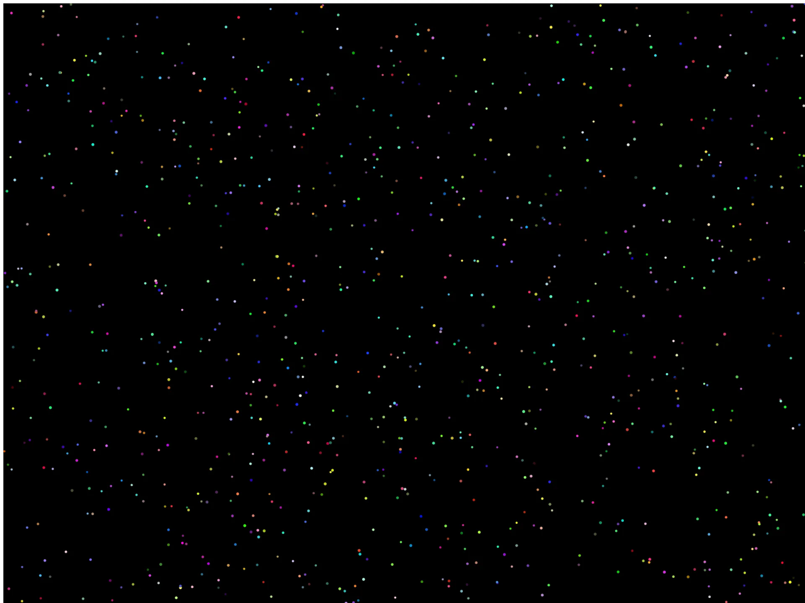

# Sound Galaxy

Visualize sound in real-time by turning audio input into a moving galaxy of particles!

Live Preview:
https://sound-galaxy.vercel.app/

## About the Project
Sound visualization is one of the coolest things that modern-day web development tools have made accessible. There’s something surreal and indescribably satisfying about seeing the sounds around you on your screen and somehow understanding what you’re seeing.

Turn on your mic, play some music, or scream as loud as you can to see the galaxy react!

## How to Use
1. Open the live preview
2. Click anywhere to turn on the mic
3. Make some noise and watch the particles react

## Tech Stack
- **p5.js** - drawing the particles on the canvas
- **p5.sound** - getting the mic input and reading the sound levels
- **JavaScript** - all the particle logic
- **HTML** - the page
- **Vercel** - hosting the live preview

## How and Why I Built It
I built this project to level up my programming skills and explore the creative possibilities of modern web development by following [this](https://workshops.hackclub.com/sound_galaxy/) Tutorial.

## Ready to explore?
Check out the live app and try different sound sources to see how the particles respond!
